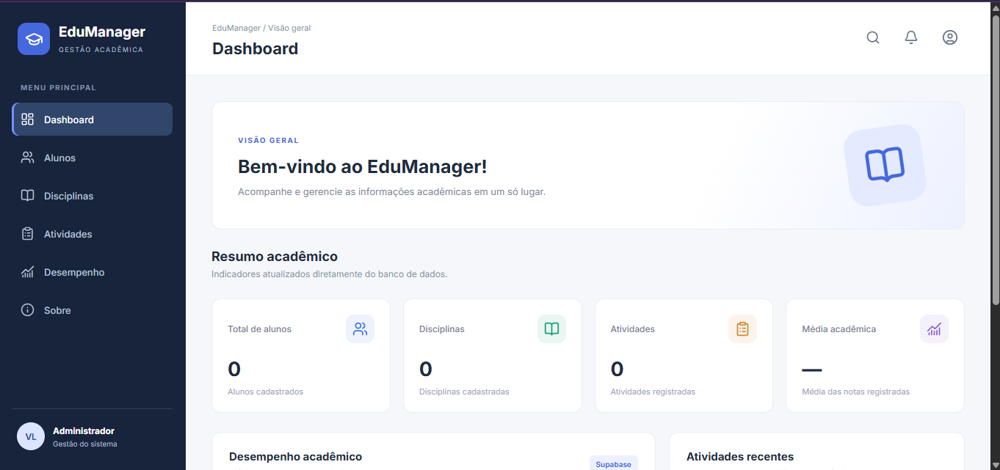
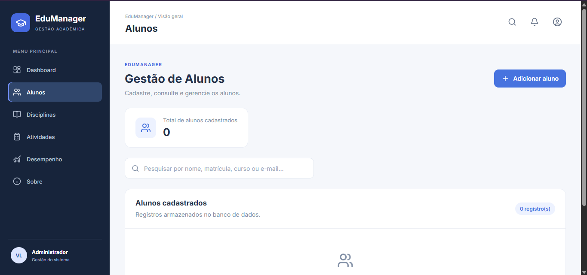
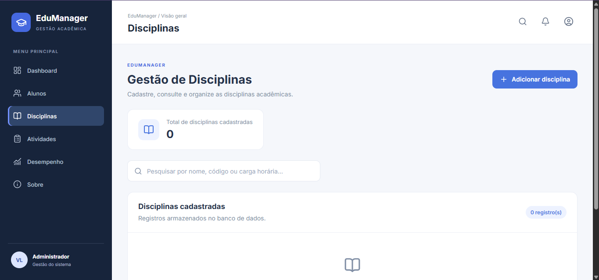
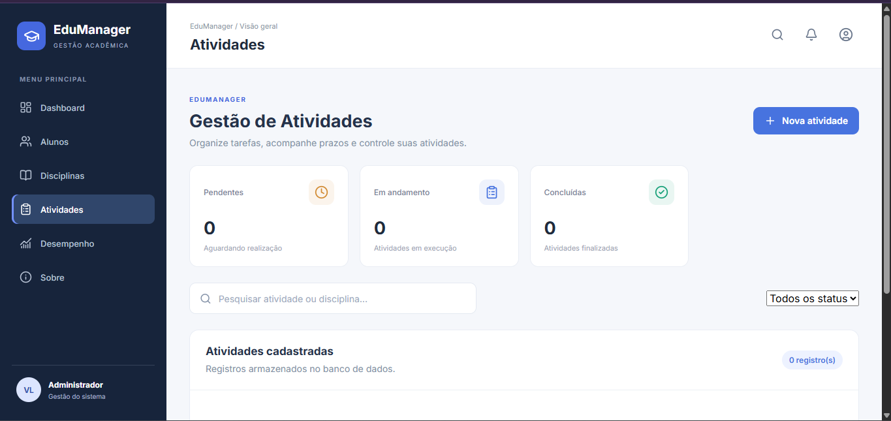
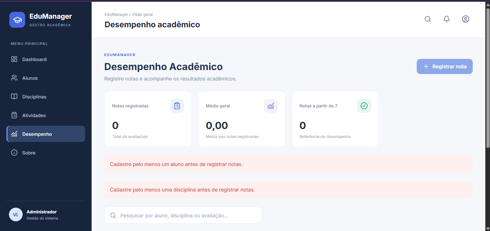
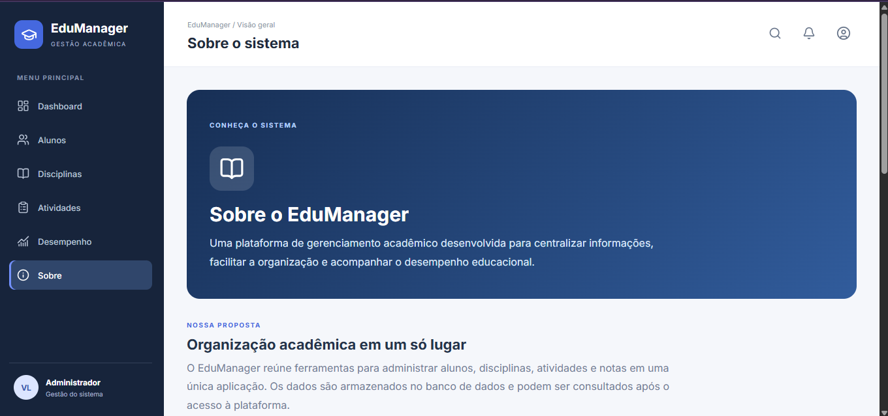
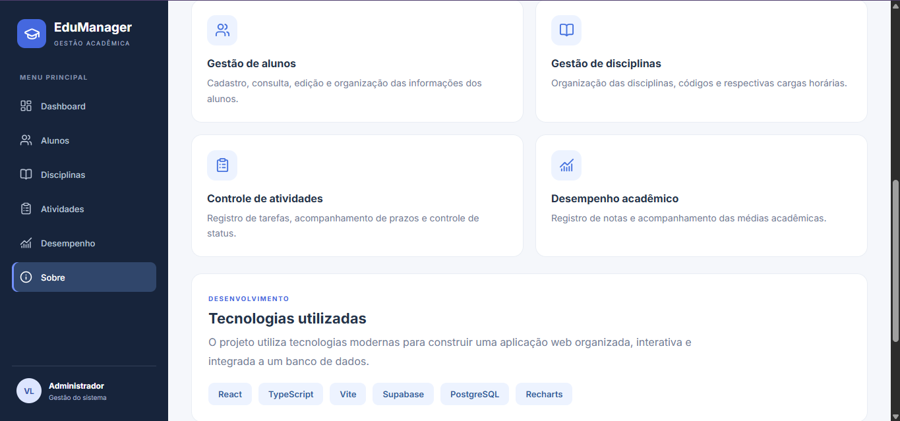
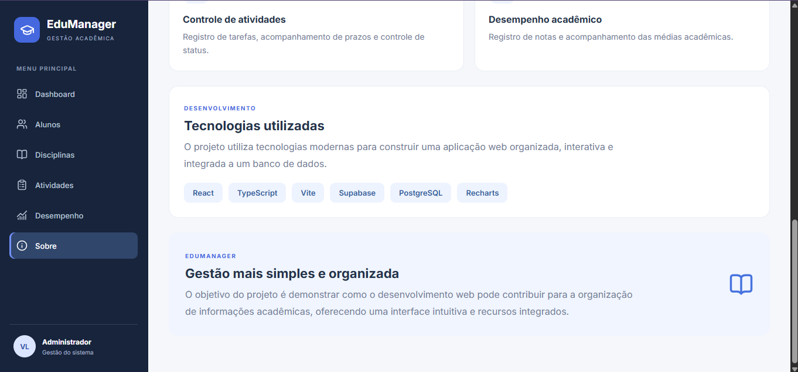

# EduManager

Sistema web de gerenciamento acadêmico desenvolvido para facilitar a organização e o acompanhamento de informações educacionais.

## Sobre o projeto

O EduManager é uma aplicação que centraliza o gerenciamento de alunos, disciplinas, atividades e desempenho acadêmico em uma interface intuitiva e organizada.

O projeto foi desenvolvido como uma aplicação web utilizando tecnologias modernas de desenvolvimento front-end e integração com banco de dados.


## Demonstração do sistema

Confira algumas telas do EduManager:

### Dashboard


### Gestão de alunos


### Gestão de disciplinas


### Gestão de atividades


### Desempenho acadêmico


### Sobre o sistema


### Funcionalidades


### Tecnologias utilizadas


## Funcionalidades

- Dashboard com indicadores acadêmicos.
- Cadastro, consulta, edição e exclusão de alunos.
- Gerenciamento de disciplinas.
- Cadastro e acompanhamento de atividades.
- Registro e consulta de notas.
- Gráficos de desempenho acadêmico.
- Histórico de atividades recentes.
- Pesquisa de páginas do sistema.
- Painel de notificações.
- Gerenciamento de sessão e autenticação.
- Interface responsiva.

## Tecnologias utilizadas

- React
- TypeScript
- Vite
- Supabase
- PostgreSQL
- React Router DOM
- Recharts
- Lucide React
- CSS

## Como executar o projeto

### Pré-requisitos

- Node.js instalado.
- npm instalado.

### Instalação

Clone o repositório:

```bash
git clone https://github.com/SEU-USUARIO/edumanager.git
```

Entre na pasta:

```bash
cd edumanager
```

Instale as dependências:

```bash
npm install
```

Configure as variáveis de ambiente em um arquivo `.env` na raiz do projeto:

```env
VITE_SUPABASE_URL=sua_url_do_supabase
VITE_SUPABASE_ANON_KEY=sua_chave_publica_do_supabase
```

Inicie a aplicação:

```bash
npm run dev
```

## Banco de dados

O projeto utiliza Supabase com PostgreSQL para autenticação e armazenamento das informações acadêmicas.

Para executar o projeto com os próprios dados, é necessário configurar um projeto Supabase e suas tabelas e políticas de acesso.

## Objetivo acadêmico

O EduManager demonstra a aplicação de conceitos de desenvolvimento web, construção de interfaces, gerenciamento de estado, operações CRUD, autenticação e integração com banco de dados.

## Autor

Projeto acadêmico desenvolvido por:

**Victor Lucas Batista e Silva**

Curso: Análise e Desenvolvimento de Sistemas

---

Desenvolvido com React, TypeScript e Supabase.
